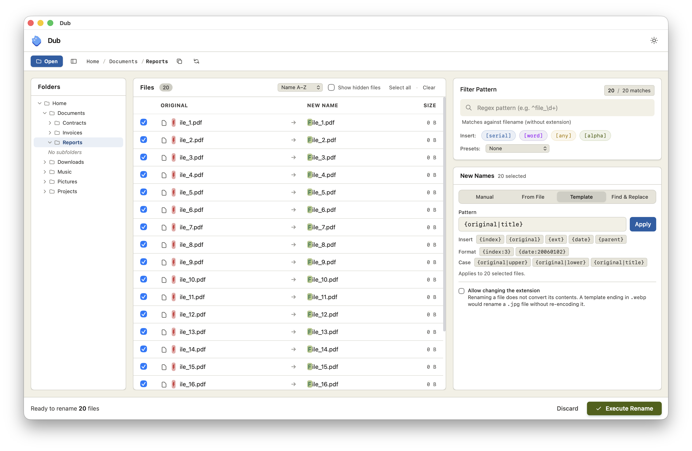

# Dub

A clean, cross-platform batch file renamer for your desktop.

Rename many files at once with templates, regular expressions, or your own list. Every rename is previewed first, and one click reverts the last batch.

<picture>
  <source media="(prefers-color-scheme: dark)" srcset="docs/screenshot-dark.png">
  
</picture>

## Install

Download the latest release for macOS (`.dmg`) or Linux (`.tar.gz`) from [Releases](https://github.com/raiven_kao/dub/releases).

Dub is unsigned, so macOS quarantines it on first launch. Remove the flag:

```sh
xattr -rd com.apple.quarantine /Applications/Dub.app
open /Applications/Dub.app
```

Or click "Cancel" on the warning, then System Settings → Privacy & Security → "Open Anyway".

## Quick Start

1. Pick a folder in the **Folders** sidebar, drag a file or folder into the window, or press `⌘O` (`Ctrl+O` on Linux).
2. Tick the files, then choose **Template**, **Find & Replace**, **From File**, or **Manual** to set the new names.
3. Check the preview. Duplicate target names are flagged and block the rename until resolved.
4. Press **Execute Rename**. **Undo** reverts the last batch, even after you move to another folder.

New names must be single filenames: paths such as `../image.jpg` or `/tmp/image.jpg` are rejected. Rename and Undo stay in the original directory, never replace files outside the batch, and stop before moving anything if the directory changed underneath them.

## Rename Safety and Recovery

Previews record the identity of the directory and each source entry. Execute and Undo reject a source that no longer has its recorded identity.
These checks do not lock out other programs. Another program can still change a file between a check and a filesystem operation.
On Linux, the filesystem must provide an entry birth time through `statx`. Dub refuses renames when this identity is unavailable.

Dub uses native directory capabilities for case-sensitivity checks. If a capability is unknown, Dub uses conservative case-insensitive comparison.
Canonically equivalent Unicode spellings count as conflicts, even on case-sensitive filesystems. These rules can reject names that the filesystem permits separately.

Before a batch starts, Dub writes a recovery journal in the target directory. If the process stops during a rename, the journal remains.

1. Open the affected folder in Dub.
2. Expand **Review recovery**.
3. Read the recovery notice.
4. Select **Restore original names**.

Recovery restores the original names and clears the current naming draft and previews. It stops if file identities or destinations are unsafe.
Keep the journal and temporary files until recovery is complete. Do not rename or delete them manually.

The journal supports recovery after a process interruption. It is not a backup or a guarantee against power loss, disk damage, or external file changes.
Undo records the last successful batch for the current application session only. It does not survive an application restart.

## Keyboard Shortcuts

| Shortcut | Action |
|---|---|
| `⌘O` / `Ctrl+O` | Open a folder |
| `⌘R` / `Ctrl+R` | Refresh |
| `⌘Enter` | Execute the rename |
| `⌘Z` / `Ctrl+Z` | Undo the last batch |
| `Esc` | Back out of a confirmation |

In the folder tree, the arrow keys move and open or close folders, and `Enter` opens one.

## Rename Modes

**Template** builds names from tokens in curly braces. The original extension is appended automatically.

| Token | Result | Example |
|---|---|---|
| `{original}` | Filename without extension | `image01` |
| `{ext}` | Extension without the dot | `jpg` |
| `{index}` | Counter from 1 | `1`, `2` |
| `{date}` | Modification date | `2023-10-27` |
| `{parent}` | Containing directory name | `Photos` |

Add a format after a colon: `{index:3}` gives `001`, and `{date:20060102}` uses Go's reference time layout. Chain pipes to transform a value: `{original|upper}`, `{original|lower}`, `{original|title}`. Unknown tokens are left as-is.

`.tar.gz` and `.tar.xz` count as one extension; any other extra dots stay in the name (`IMG.2024.jpg` has the stem `IMG.2024`).

**Find & Replace** takes a Go regular expression (RE2) and matches it against the filename without its extension. Use `$1`, `$2` for capture groups; files that do not match keep their name.

- Search: `IMG_(\d+)`
- Replace: `Photo_$1`

**From File** loads names from a `.txt` or `.csv` file with one name per line: click the drop zone or drag the file onto it. **Manual** lets you type each new name beside its file.

Name lists have a 4 MiB content limit, a 4,096-byte line limit, and a limit of 100,000 nonempty names.
If an import exceeds a limit or cannot be read completely, Dub keeps the previous names.

## Filtering

The filter box takes a Go regular expression, matched against the filename without its extension. These shortcuts expand before the pattern compiles:

| Shortcut | Expands to | Matches |
|---|---|---|
| `[serial]`, `[number]` | `(\d+)` | Digits |
| `[word]` | `(\w+)` | Word characters |
| `[alpha]` | `([a-zA-Z]+)` | Letters |
| `[any]` | `(.*)` | Anything |

Files sort naturally (`file_2` before `file_10`); the sort menu also orders by modification time or size, and `{index}` follows the order you see. Hidden files are left out and never renamed unless you tick **Show hidden files** and select them yourself.

## Development

Common tasks are defined in `Taskfile.yml` and run through [Task](https://taskfile.dev/).

```sh
task dev      # templ + tailwind watchers, then go run .
task build    # production build via wails3
task package  # .dmg on macOS, .tar.gz on Linux
task test     # Go race tests and frontend regression tests
task check    # go vet, golangci-lint, govulncheck
```

You need [Go](https://go.dev/dl/) 1.27+, [Task](https://taskfile.dev/), the [Wails v3](https://v3.wails.io/getting-started/installation/) CLI (`wails3`), and the Tailwind CSS standalone CLI at `./tailwindcss` in the repository root. Templ, golangci-lint, and govulncheck come from `go.mod`.

`go build ./...` and `go test ./...` also work on a fresh clone, since the generated CSS and vendored htmx are committed. There is no `wails3 dev`: dub has no bundler to proxy to, so `task dev` runs the watchers and the app directly. Wails build settings live in `build/config.yml`; run `wails3 task common:update:build-assets` after changing the app metadata.

Real-browser smoke tests use the application handlers, the committed frontend assets, and temporary files.
See [the browser test guide](web/tests/browser/README.md) for commands and the separate native WebView checklist.
Browser tests do not verify the native directory picker, native file-drop delivery, or platform IME behavior.

## License

[MIT](LICENSE)
